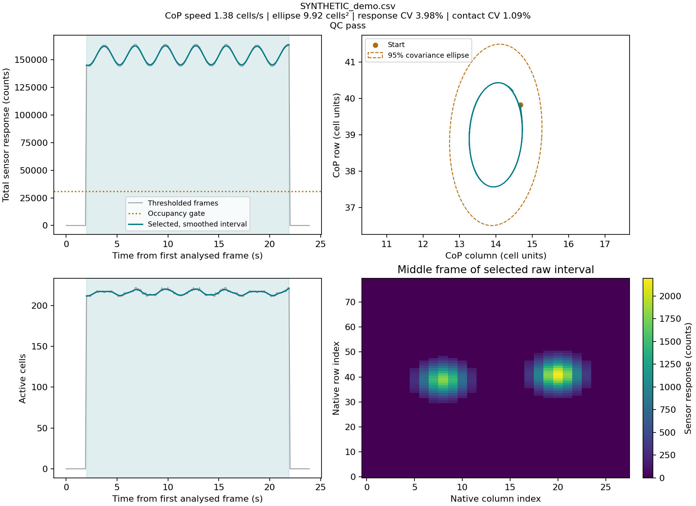

# SensingTex Fitness Mat GUI and offline features

Python software for collecting and displaying **80 × 28** SensingTex Fitness Mat frames, with an offline package for reproducible centre-of-pressure (CoP) and contact features. Developed in the Tuscany Health Ecosystem (THE) project.

The repository contains two independently usable components:

| Component | Entry point | Purpose |
| --- | --- | --- |
| Desktop GUI | `python main.py` | Serial acquisition, live heatmap and CoP marker, CSV recording |
| Offline extractor | `python -m mat_features` or `mat-features` | Batch processing, four recording-level features, quality audit, traces and plots |

The extractor works without a connected mat or Qt. The desktop application’s operation and device-specific assumptions are described in [docs/GUI.md](docs/GUI.md).

## What is extracted?

| Output column | Meaning | Unit |
| --- | --- | --- |
| `cop_speed` | CoP path length divided by the selected interval's duration | Grid cells/s |
| `cop_ellipse` | Area of the 95% covariance ellipse of the CoP trajectory | Grid cells² |
| `load_cv` | Variability of total sensor response relative to its mean | Ratio |
| `contact_cv` | Variability of the number of active cells relative to its mean | Ratio |

Additional columns include path length, both CVs as percentages, interval boundaries, occupancy, quality flags, source hashes and filename/date checks. Sensor response is in device counts; this software does not convert it to newtons, kilograms or calibrated pressure.

The automatic interval selector finds the **longest continuously occupied interval**, separating unloaded frames and acquisition gaps. It does not identify individual squat or deadlift events. Features describe the selected interval, which can contain preparation or recovery. Review the diagnostic plots before interpreting a recording as a particular exercise.

## Quick start on Windows

Install Python 3.12, open a terminal in the repository directory, and run:

```powershell
py -3.12 -m venv .venv
.\.venv\Scripts\python.exe -m pip install ".[plots]"
.\.venv\Scripts\python.exe -m mat_features demo --output demo_data
.\.venv\Scripts\python.exe -m mat_features extract demo_data --output demo_results --plots --save-traces
```

The example is generated mathematically and labelled **SYNTHETIC**. No participant recordings or scores are included.

For your recordings, use a separate output folder for each run:

```powershell
.\.venv\Scripts\python.exe -m mat_features extract "C:\THE\recordings" --output "C:\THE\feature_results" --plots --save-traces
```

Directories are searched recursively. The original folder hierarchy is recorded in `source_path`, so files with the same basename remain distinct. CSVs without a mat-like first row are listed in `skipped_files.csv`; explicit file inputs are always validated. Trainer-score CSVs are not analysis inputs.

To also run the live GUI:

```powershell
.\.venv\Scripts\python.exe -m pip install -r requirements.txt
.\.venv\Scripts\python.exe main.py
```

Run these commands from the repository root. The GUI uses the original pinned dependencies in `requirements.txt`; offline dependencies are declared in `pyproject.toml`. On Linux/macOS use `python3 -m venv .venv` and `.venv/bin/python` in place of the Windows executable.

## Outputs

| File | Contents |
| --- | --- |
| `features.csv` | One row per recording and extraction setting, including explicit ineligible rows with blank features |
| `quality_audit.csv` | One row per successfully parsed recording, dates, frame counts, SHA-256, gaps and quality flags |
| `processing_errors.csv` | Files rejected because of malformed data, inconsistent dates or read errors |
| `skipped_files.csv` | Non-mat CSVs ignored during directory discovery |
| `run_manifest.json` | Exact configuration, software versions, processing counts and header policy |
| `traces/*.npz` | Optional primary-setting signals and selected maps; numeric arrays loadable with `allow_pickle=False` |
| `plots/*.png` | Optional primary-setting diagnostic plots |

Quality flags **do not remove estimates**. Invalid recordings receive an error record; valid recordings without an eligible interval receive a blank feature row. The command exits with code `2` if any recording fails validation, while retaining the valid outputs for inspection. A clean run, including properly reported ineligible intervals, exits with code `0`. Existing nonempty output folders are refused.

## Example plot



This figure is generated from the included synthetic-data generator. The highlighted interval is selected automatically; it is not an annotated exercise event.

## Configuration and earlier-analysis compatibility

Defaults: threshold 150 counts, occupancy at least 5,000 counts or 20% of median positive response (whichever is higher), gaps split above 1 s, raw interval at least 5 s and 6 frames, resampling at the interval's median spacing, Gaussian smoothing with standard deviation 0.25 s.

```powershell
.\.venv\Scripts\python.exe -m mat_features extract "C:\THE\recordings" --output "C:\THE\sensitivity_results" --config config\default.json --sensitivity
```

`--sensitivity` adds thresholds 100/150/200 and symmetric end trims of 0/10%, retaining the configured primary setting. The configuration and all outcomes are exported; no condition or score is used to select a favourable setting.

**Header correction:** older analysis scripts unconditionally skipped the first CSV line. Historical headerless recordings therefore lost one data frame each. This release detects the header and preserves all data rows by default. To reproduce that specific earlier processing behaviour, use:

```powershell
.\.venv\Scripts\python.exe -m mat_features extract "C:\THE\recordings" --output "C:\THE\legacy_results" --legacy-skip-first-line --sensitivity
```

Compatibility mode is explicitly recorded in the output and is intended for reproducibility. Do not mix results produced with different header policies. See [validation and migration notes](docs/VALIDATION.md) for the measured effect on the available historical recordings.

## Python API

```python
from mat_features import ExtractionConfig, extract_file

result = extract_file("recording.csv", ExtractionConfig(), sensitivity=True)
for row in result.features:
    if row["is_primary"] and row["status"] == "ok":
        print(row["cop_speed"], row["cop_ellipse"], row["qc_flags"])
```

`extract_arrays(timestamps, sensor_matrix, config)` also accepts an N-element time vector and an N × 2240 sensor array. Inputs are not modified. See [docs/FEATURES.md](docs/FEATURES.md) for coordinate conventions, units, segmentation, filtering, quality policies and the output schema.

## Tests

```powershell
.\.venv\Scripts\python.exe -m unittest discover -s tests -v
```

Install `.[plots]` before running the full suite. Fixtures are generated synthetic arrays; no study dataset is needed. Tests cover numerical definitions, header handling, malformed data, gap splitting, date checks, source identity, CLI errors, traces and plotting. Tested versions and historical-recording comparisons are documented in [docs/VALIDATION.md](docs/VALIDATION.md).

## License

Apache License 2.0; see [LICENSE](LICENSE). No calibration, clinical validation or validated task recognition is implied by the research feature definitions.
